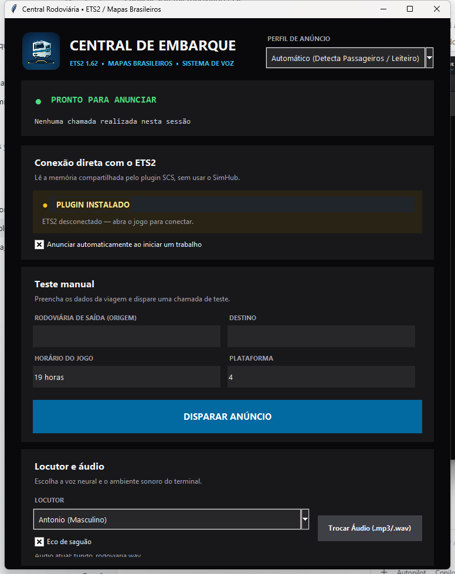
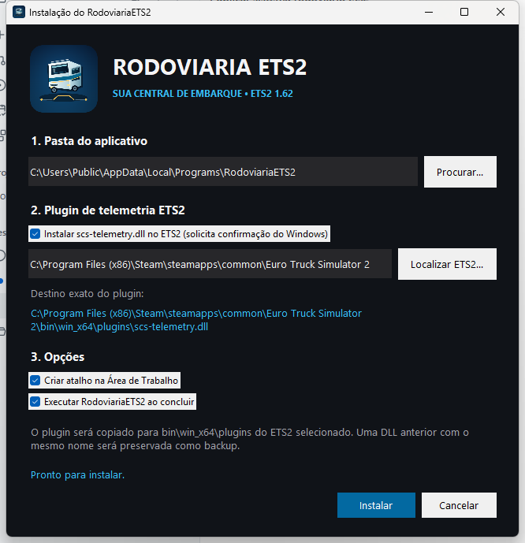

# Sistema de Voz Rodoviária para ETS2

Aplicativo em português para anúncios no **Euro Truck Simulator 2 1.62**, sem depender do SimHub em execução. A conexão direta lê a memória compartilhada `Local\SCSTelemetry`, publicada pelo plugin SCS `scs-telemetry.dll` (RenCloud) instalado no ETS2. A normalização de cidades foi preparada para nomes dos mapas brasileiros **Mapa Eldorado, Mapa EAA, Rotas Brasil e RBR**, além de outros mapas. O painel oferece os modos **Passageiros (Rodoviária)** e **Leiteiro **, além de controles de voz e volume.

## Conheça o aplicativo

O painel reúne o estado da conexão com o jogo, os dados da viagem detectados pela telemetria e os controles para testar ou personalizar o anúncio. A imagem abaixo mostra o plugin encontrado e o ETS2 aguardando ser iniciado:



No assistente de instalação, escolha a pasta principal do ETS2, confira o caminho completo de destino do plugin e marque as opções desejadas. É possível instalar o aplicativo, copiar `scs-telemetry.dll`, criar um atalho na Área de Trabalho e abrir o painel ao terminar:



**Próximo:** clique em **Instalar** para concluir. Se a opção de execução estiver marcada, o RodoviariaETS2 abrirá em seguida; caso contrário, abra o aplicativo pelo atalho criado na Área de Trabalho.

### Fluxo de uso

1. Execute o instalador e selecione a instalação correta do Euro Truck Simulator 2.
2. Confirme a instalação do plugin no caminho `bin\win_x64\plugins\scs-telemetry.dll`. Se o Windows solicitar, autorize a cópia.
3. Inicie o ETS2 e carregue um trabalho; depois abra o RodoviariaETS2.
4. Confira no painel o estado da telemetria e os dados da viagem. Com o anúncio automático habilitado, o sistema identifica o tipo de carga e anuncia quando um novo trabalho começa.
5. Se preferir, desative o anúncio automático, preencha os campos de teste manualmente e use **DISPARAR ANÚNCIO**.

O status **PLUGIN INSTALADO** confirma que o arquivo foi encontrado; ele não significa que o jogo já está conectado. A conexão fica ativa quando o ETS2 está aberto e o plugin está publicando os dados. O painel também permite selecionar uma voz, habilitar o eco, trocar o áudio de fundo e ajustar separadamente os volumes da voz, do ambiente e da campainha.

## Requisitos

- Windows e Python **3.15 ou superior**, com `tkinter`.
- Pacotes Python `edge-tts` e `static-ffmpeg`.
- PyInstaller para compilar o executável.
- O plugin de telemetria `scs-telemetry.dll` (RenCloud), distribuído separadamente.

Instale as dependências:

```powershell
py -3.15 -m pip install edge-tts static-ffmpeg pyinstaller
```

## Instalar e conectar o plugin de telemetria

O instalador do Windows inclui o plugin oficial RenCloud e o coloca exatamente em `bin\win_x64\plugins` dentro da instalação do jogo. O caminho padrão Steam é:

```text
C:\Program Files (x86)\Steam\steamapps\common\Euro Truck Simulator 2\bin\win_x64\plugins\scs-telemetry.dll
```

Baixe e execute o [instalador RodoviariaETS2 para Windows](https://github.com/Messias8888437/sistema-voz-rodoviaria-ets2/releases/download/v1.1.0/RodoviariaETS2-Setup.exe). Selecione a pasta principal do ETS2, confirme o destino exibido na tela e aceite a solicitação do Windows para copiar a DLL para a pasta protegida do jogo. O instalador preserva uma DLL anterior de mesmo nome como backup, oferece a criação de atalho na Área de Trabalho e pode abrir o aplicativo ao concluir.

O instalador e o aplicativo têm ícone próprio do RodoviariaETS2; o mesmo visual aparece na janela e no atalho da Área de Trabalho.

Também é possível instalar manualmente: feche o ETS2 e copie `scs-telemetry.dll` para a pasta acima. Inicie o ETS2 e depois abra o aplicativo. O painel lê diretamente a memória compartilhada `Local\SCSTelemetry`, criada pelo plugin quando o jogo carrega. Não é necessário instalar `ETS2Telemetry_x64.dll` ou `SHEETS2Telemetry_x64.dll`, nem abrir o SimHub.

O status **Conexão direta com o ETS2** no painel mostra quando o plugin está publicando telemetria, se há um trabalho ativo, origem, destino, horário do jogo e carga. Enquanto estiver conectado, os campos do painel são atualizados com os dados do jogo. A opção **Anunciar automaticamente ao iniciar um trabalho** dispara um anúncio quando a telemetria sinaliza um novo trabalho; desmarque-a para apenas acompanhar os dados e fazer anúncios manuais.

Quando o ETS2 está fechado, o painel verifica a pasta do jogo e mostra **PLUGIN INSTALADO** com a indicação curta “ETS2 desconectado — abra o jogo para conectar”; quando o jogo e o plugin conectam, o indicador fica verde. Se a DLL não for encontrada, o painel avisa que o plugin não está instalado. O ícone do ônibus identifica o instalador, o aplicativo, a janela e o atalho na Área de Trabalho.

Se o painel mostrar **PLUGIN NÃO ENCONTRADO**, confira se `scs-telemetry.dll` está na pasta acima e reinicie o aplicativo. Se mostrar **PLUGIN INSTALADO** mas o ETS2 estiver desconectado, abra ou reinicie o jogo. A DLL é um componente separado e o aplicativo só lê a memória publicada por ela; não injeta código nem altera os arquivos do jogo.

## Formatação de cidades

`telemetria_ets2.py` expõe `limpar_cidade`, usada pelo motor nos nomes de origem e destino. Ela remove siglas das 27 UFs no final (por exemplo, `Sao_Paulo-SP`, `Santos (SP)` ou `Curitiba/PR`), normaliza underlines e hífens usados como separadores e corrige acentos de capitais e de cidades comuns nos mapas brasileiros. O dicionário inclui, entre outras, Juquiá, Pariquera-Açu, Cananéia, Apiaí, Capão Bonito, São Lourenço da Serra, Jacupiranga, Eldorado, Sete Barras e cidades do litoral sul paulista.

Nomes que não estejam no dicionário também têm UFs e separadores normalizados e são preservados; a lista de acentos é extensível conforme novos mapas adicionem cidades.

## Executar o painel

Na pasta do projeto:

```powershell
python app_rodoviaria.py
```

O painel salva preferências em `config_rodoviaria.json`. O anúncio usa `falar_rodoviaria.py`, que gera a locução com edge-tts, mistura o áudio com FFmpeg e reproduz o resultado. É necessária uma conexão com o serviço edge-tts. Mantenha `campainha.wav` e um áudio de fundo (`fundo_rodoviaria.wav` ou `fundo_rodoviaria.mp3`) ao lado dos scripts.

### Executar `RodoviariaETS2.exe`

Recomenda-se usar o [instalador para Windows](https://github.com/Messias8888437/sistema-voz-rodoviaria-ets2/releases/download/v1.1.0/RodoviariaETS2-Setup.exe), que instala o painel e o motor independente, configura o plugin no ETS2 e permite criar um atalho. Essa instalação não exige Python no computador de destino. É necessária conexão com a internet para gerar a voz com edge-tts; o FFmpeg/FFprobe é baixado na primeira locução e armazenado em `%LOCALAPPDATA%\RodoviariaETS2\ffmpeg` para reutilização.

O executável avulso [RodoviariaETS2.exe da release v1.0.0](https://github.com/Messias8888437/sistema-voz-rodoviaria-ets2/releases/download/v1.0.0/RodoviariaETS2.exe) é uma versão anterior do painel: para usá-lo, mantenha `falar_rodoviaria.py`, `telemetria_ets2.py`, `config_rodoviaria.json`, `campainha.wav` e um áudio de fundo (`fundo_rodoviaria.wav` ou `fundo_rodoviaria.mp3`) ao lado do executável e tenha Python 3.15+, `edge-tts` e `static-ffmpeg` instalados e disponíveis no PATH.

O suporte aos mapas é independente do SimHub e do mapa carregado: o motor normaliza os nomes de origem e destino recebidos do plugin, incluindo separadores, siglas de estados e acentos conhecidos. Também é possível informar a viagem manualmente. O perfil automático usa o nome da carga lido da telemetria (ou fornecido por `--cargo`): cargas de leite e laticínios selecionam **Leiteiro (Coleta de Leite)**; as demais selecionam **Passageiros (Rodoviária)**. Os modos também podem ser escolhidos manualmente no painel.

Exemplo de chamada direta do motor:

```powershell
python falar_rodoviaria.py --origem "São Paulo" --destino "Campinas" --hora "19 horas" --plataforma "4"
```

## Modos de anúncio

O painel oferece os perfis **Automático**, **Passageiros (Rodoviária)** e **Leiteiro (Coleta de Leite)**. Os modos passageiros e leiteiro geram anúncios e mixagens de áudio diferentes; os modos também podem ser selecionados diretamente no motor:

| Perfil | Como é selecionado | Uso |
| --- | --- | --- |
| Automático | Detecta o nome da carga informado pelo jogo | Cargas de leite e laticínios usam o modo Leiteiro; as demais usam Passageiros |
| Passageiros (Rodoviária) | Seleção manual no painel ou `--modo rodoviaria` | Anúncio no estilo de embarque rodoviário |
| Leiteiro (Coleta de Leite) | Seleção manual no painel ou `--modo leiteiro` | Anúncio no estilo de coleta e transporte de leite |

```powershell
python falar_rodoviaria.py --origem "São Paulo" --destino "Campinas" --hora "19 horas" --modo rodoviaria
python falar_rodoviaria.py --origem "Fazenda A" --destino "Laticínio B" --hora "19 horas" --modo leiteiro
```

Com a conexão ativa ao plugin, o perfil automático classifica a carga lida do ETS2: termos como `leite`, `milk`, `laticin`, `queijo`, `iogurte` ou `tanque` selecionam o modo leiteiro; as demais cargas selecionam o modo rodoviária. Na chamada direta do motor, informe `--cargo` para usar essa mesma detecção. O painel também permite forçar qualquer modo.

Nos mapas brasileiros, origem e destino são lidos dos dados do trabalho e normalizados antes de serem falados. O horário vem do relógio do jogo. O sistema usa os dados de telemetria disponíveis, sem depender de um mapa específico ou de um serviço externo como o SimHub.

## Compilar o painel

```powershell
py -3.15 -m pip install edge-tts static-ffmpeg pyinstaller
powershell -ExecutionPolicy Bypass -File .\installer\build_installer.ps1
```

O script compila o painel, o motor independente e o instalador `dist\RodoviariaETS2-Setup.exe`. Ele baixa a release RenCloud V.1.12.1, verifica o SHA-256 esperado do plugin antes de empacotá-lo e copia o instalador para a Área de Trabalho. O instalador inclui `THIRD-PARTY-NOTICES.txt` com a licença MIT do plugin.

## Arquivos principais

- `app_rodoviaria.py`: painel gráfico.
- `falar_rodoviaria.py`: geração, mixagem e reprodução dos anúncios.
- `telemetria_ets2.py`: leitura do mapa de memória compartilhada do plugin SCS, formatação de cidades e classificação da carga.
- `gerar_audios.py`: geração dos arquivos WAV de campainha e áudio de fundo.
- `campainha.wav` e `fundo_rodoviaria.wav`: efeitos sonoros usados na mixagem.
